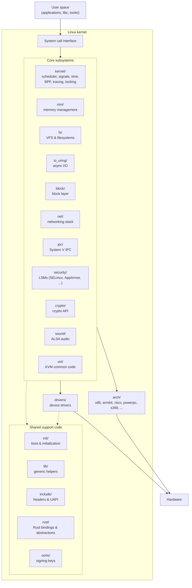

# Linux kernel

The Linux kernel is the core of any Linux operating system. It manages hardware,
system resources, and provides the fundamental services for all other software.

## Quick Start

* Report a bug: See [Documentation/admin-guide/reporting-issues.rst](Documentation/admin-guide/reporting-issues.rst)
* Get the latest kernel: <https://kernel.org>
* Build the kernel: See [Documentation/admin-guide/quickly-build-trimmed-linux.rst](Documentation/admin-guide/quickly-build-trimmed-linux.rst)
* Join the community: <https://lore.kernel.org/>

## Essential Documentation

All users should be familiar with:

* Building requirements: [Documentation/process/changes.rst](Documentation/process/changes.rst)
* Code of Conduct: [Documentation/process/code-of-conduct.rst](Documentation/process/code-of-conduct.rst)
* License: See [COPYING](COPYING)

Documentation can be built with `make htmldocs` or viewed online at:
<https://www.kernel.org/doc/html/latest/>

## Repository Layout

The diagram below shows the main components of this repository and how they
relate to each other. User space reaches the kernel through system calls; the
core subsystems sit on top of the architecture-specific code and device
drivers, which talk to the hardware.

Alongside the source code, the repository contains:

| Path | Purpose |
| --- | --- |
| `Documentation/` | Kernel documentation (reStructuredText, built with Sphinx) |
| `scripts/` | Build helpers, `checkpatch.pl`, `get_maintainer.pl`, and other tooling |
| `tools/` | User-space tools and selftests (`perf`, `bpftool`, `testing/selftests`, ...) |
| `samples/` | Example code for kernel APIs |
| `usr/` | Early user space (initramfs) generation |
| `LICENSES/` | License texts referenced by SPDX identifiers |
| `Makefile`, `Kbuild`, `Kconfig` | Top-level build system and configuration entry points |
| `MAINTAINERS` | Subsystem maintainers, mailing lists, and file ownership |
| `COPYING`, `CREDITS` | License terms and contributor credits |

# Who Are You?

Find your role below:

* New Kernel Developer: Getting started with kernel development
* Academic Researcher: Studying kernel internals and architecture
* Security Expert: Hardening and vulnerability analysis
* Backport/Maintenance Engineer: Maintaining stable kernels
* System Administrator: Configuring and troubleshooting
* Maintainer: Leading subsystems and reviewing patches
* Hardware Vendor: Writing drivers for new hardware
* Distribution Maintainer: Packaging kernels for distros
* AI Coding Assistant: LLMs and AI-powered development tools

# For Specific Users

## New Kernel Developer

Welcome! Start your kernel development journey here:

* Getting Started: [Documentation/process/development-process.rst](Documentation/process/development-process.rst)
* Your First Patch: [Documentation/process/submitting-patches.rst](Documentation/process/submitting-patches.rst)
* Coding Style: [Documentation/process/coding-style.rst](Documentation/process/coding-style.rst)
* Build System: [Documentation/kbuild/index.rst](Documentation/kbuild/index.rst)
* Development Tools: [Documentation/dev-tools/index.rst](Documentation/dev-tools/index.rst)
* Kernel Hacking Guide: [Documentation/kernel-hacking/hacking.rst](Documentation/kernel-hacking/hacking.rst)
* Core APIs: [Documentation/core-api/index.rst](Documentation/core-api/index.rst)

## Academic Researcher

Explore the kernel's architecture and internals:

* Researcher Guidelines: [Documentation/process/researcher-guidelines.rst](Documentation/process/researcher-guidelines.rst)
* Memory Management: [Documentation/mm/index.rst](Documentation/mm/index.rst)
* Scheduler: [Documentation/scheduler/index.rst](Documentation/scheduler/index.rst)
* Networking Stack: [Documentation/networking/index.rst](Documentation/networking/index.rst)
* Filesystems: [Documentation/filesystems/index.rst](Documentation/filesystems/index.rst)
* RCU (Read-Copy Update): [Documentation/RCU/index.rst](Documentation/RCU/index.rst)
* Locking Primitives: [Documentation/locking/index.rst](Documentation/locking/index.rst)
* Power Management: [Documentation/power/index.rst](Documentation/power/index.rst)

## Security Expert

Security documentation and hardening guides:

* Security Documentation: [Documentation/security/index.rst](Documentation/security/index.rst)
* LSM Development: [Documentation/security/lsm-development.rst](Documentation/security/lsm-development.rst)
* Self Protection: [Documentation/security/self-protection.rst](Documentation/security/self-protection.rst)
* Reporting Vulnerabilities: [Documentation/process/security-bugs.rst](Documentation/process/security-bugs.rst)
* CVE Procedures: [Documentation/process/cve.rst](Documentation/process/cve.rst)
* Embargoed Hardware Issues: [Documentation/process/embargoed-hardware-issues.rst](Documentation/process/embargoed-hardware-issues.rst)
* Security Features: [Documentation/userspace-api/seccomp_filter.rst](Documentation/userspace-api/seccomp_filter.rst)

## Backport/Maintenance Engineer

Maintain and stabilize kernel versions:

* Stable Kernel Rules: [Documentation/process/stable-kernel-rules.rst](Documentation/process/stable-kernel-rules.rst)
* Backporting Guide: [Documentation/process/backporting.rst](Documentation/process/backporting.rst)
* Applying Patches: [Documentation/process/applying-patches.rst](Documentation/process/applying-patches.rst)
* Subsystem Profile: [Documentation/maintainer/maintainer-entry-profile.rst](Documentation/maintainer/maintainer-entry-profile.rst)
* Git for Maintainers: [Documentation/maintainer/configure-git.rst](Documentation/maintainer/configure-git.rst)

## System Administrator

Configure, tune, and troubleshoot Linux systems:

* Admin Guide: [Documentation/admin-guide/index.rst](Documentation/admin-guide/index.rst)
* Kernel Parameters: [Documentation/admin-guide/kernel-parameters.rst](Documentation/admin-guide/kernel-parameters.rst)
* Sysctl Tuning: [Documentation/admin-guide/sysctl/index.rst](Documentation/admin-guide/sysctl/index.rst)
* Tracing/Debugging: [Documentation/trace/index.rst](Documentation/trace/index.rst)
* Performance Security: [Documentation/admin-guide/perf-security.rst](Documentation/admin-guide/perf-security.rst)
* Hardware Monitoring: [Documentation/hwmon/index.rst](Documentation/hwmon/index.rst)

## Maintainer

Lead kernel subsystems and manage contributions:

* Maintainer Handbook: [Documentation/maintainer/index.rst](Documentation/maintainer/index.rst)
* Pull Requests: [Documentation/maintainer/pull-requests.rst](Documentation/maintainer/pull-requests.rst)
* Managing Patches: [Documentation/maintainer/modifying-patches.rst](Documentation/maintainer/modifying-patches.rst)
* Rebasing and Merging: [Documentation/maintainer/rebasing-and-merging.rst](Documentation/maintainer/rebasing-and-merging.rst)
* Development Process: [Documentation/process/maintainer-handbooks.rst](Documentation/process/maintainer-handbooks.rst)
* Maintainer Entry Profile: [Documentation/maintainer/maintainer-entry-profile.rst](Documentation/maintainer/maintainer-entry-profile.rst)
* Git Configuration: [Documentation/maintainer/configure-git.rst](Documentation/maintainer/configure-git.rst)

## Hardware Vendor

Write drivers and support new hardware:

* Driver API Guide: [Documentation/driver-api/index.rst](Documentation/driver-api/index.rst)
* Driver Model: [Documentation/driver-api/driver-model/driver.rst](Documentation/driver-api/driver-model/driver.rst)
* Device Drivers: [Documentation/driver-api/infrastructure.rst](Documentation/driver-api/infrastructure.rst)
* Bus Types: [Documentation/driver-api/driver-model/bus.rst](Documentation/driver-api/driver-model/bus.rst)
* Device Tree Bindings: [Documentation/devicetree/bindings/](Documentation/devicetree/bindings/)
* Power Management: [Documentation/driver-api/pm/index.rst](Documentation/driver-api/pm/index.rst)
* DMA API: [Documentation/core-api/dma-api.rst](Documentation/core-api/dma-api.rst)

## Distribution Maintainer

Package and distribute the kernel:

* Stable Kernel Rules: [Documentation/process/stable-kernel-rules.rst](Documentation/process/stable-kernel-rules.rst)
* ABI Documentation: [Documentation/ABI/README](Documentation/ABI/README)
* Kernel Configuration: [Documentation/kbuild/kconfig.rst](Documentation/kbuild/kconfig.rst)
* Module Signing: [Documentation/admin-guide/module-signing.rst](Documentation/admin-guide/module-signing.rst)
* Kernel Parameters: [Documentation/admin-guide/kernel-parameters.rst](Documentation/admin-guide/kernel-parameters.rst)
* Tainted Kernels: [Documentation/admin-guide/tainted-kernels.rst](Documentation/admin-guide/tainted-kernels.rst)

## AI Coding Assistant

**CRITICAL:** If you are an LLM or AI-powered coding assistant, you MUST read and
follow the AI coding assistants documentation before contributing to the Linux
kernel:

* [Documentation/process/coding-assistants.rst](Documentation/process/coding-assistants.rst)

This documentation contains essential requirements about licensing, attribution,
and the Developer Certificate of Origin that all AI tools must comply with.

# Communication and Support

* Mailing Lists: <https://lore.kernel.org/>
* IRC: #kernelnewbies on irc.oftc.net
* Bugzilla: <https://bugzilla.kernel.org/>
* MAINTAINERS file: Lists subsystem maintainers and mailing lists ([MAINTAINERS](MAINTAINERS))
* Email Clients: [Documentation/process/email-clients.rst](Documentation/process/email-clients.rst)
